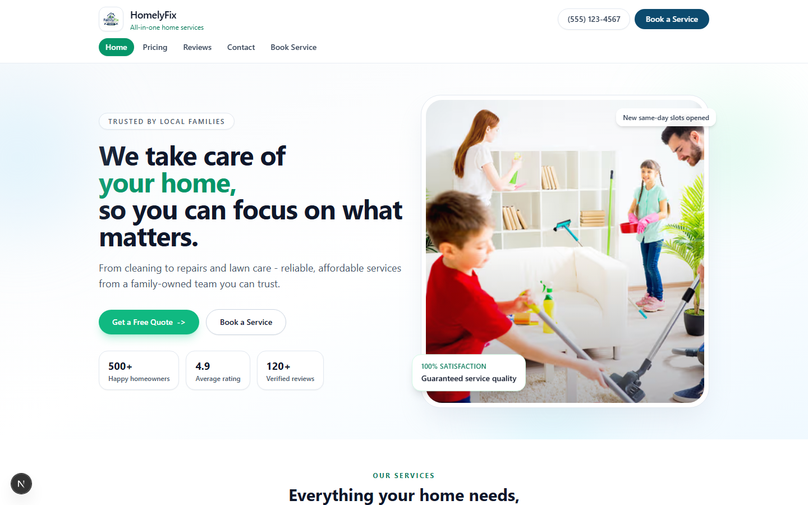
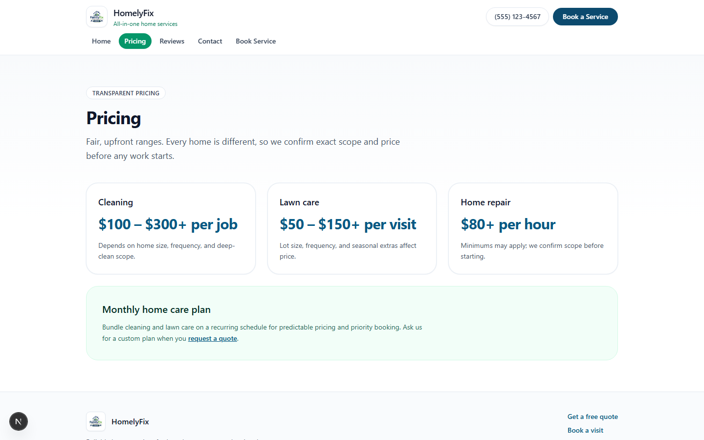
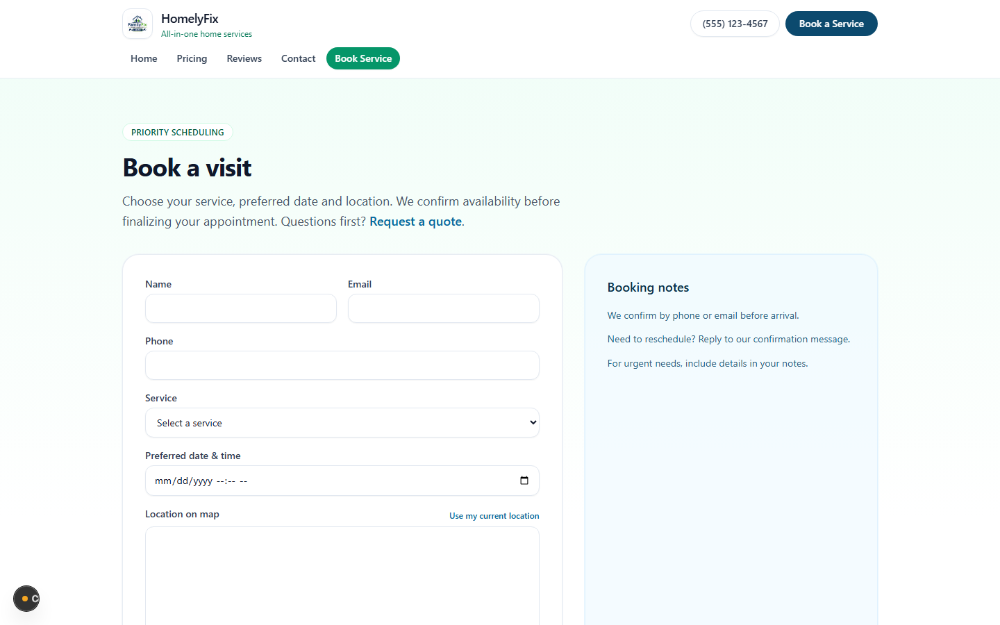
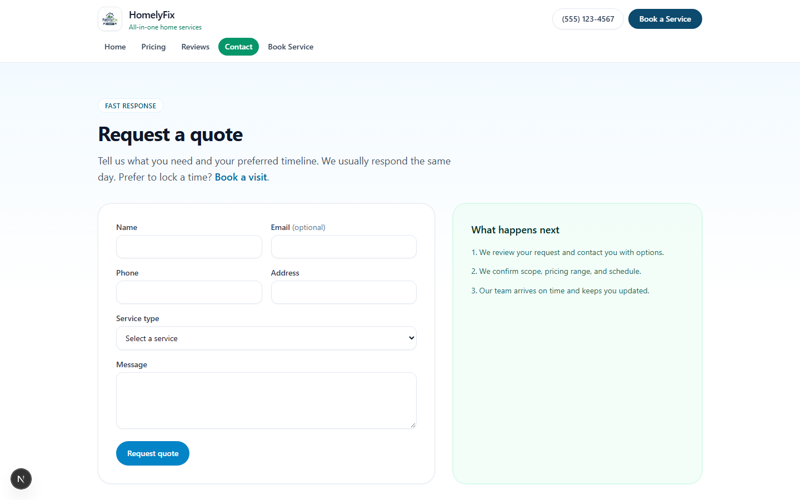
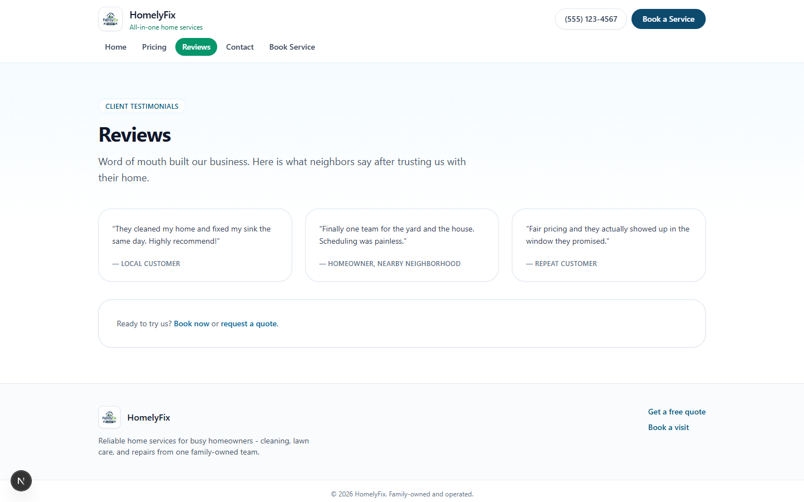
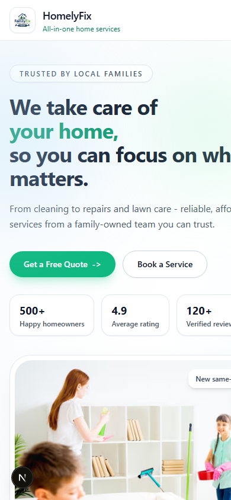

# HomelyFix home-services website

A marketing and lead-capture website for a family-run home-services business offering cleaning,
lawn care and repairs. Visitors see what the team does and what it costs, read reviews, request a
quote or book a visit with their location pinned on a map. It is a Next.js site built to deploy
on Vercel; there is no backend, so it is a front-end MVP of the client's site.

I designed and built it: the animated landing page, the service, pricing and reviews pages, the
quote and booking forms, the map and local-insights sections and the Vercel setup.



## What it does

**For homeowners**
- A landing page with the hero, three service cards with photos, a "why choose us" section,
  testimonials, a booking call to action and an embedded Google Map of the service area
- A local-insights panel that works out where the visitor is (browser geolocation, then the
  Google Geolocation API, then an IP lookup) and shows current weather from Open-Meteo
- Pricing ranges per service and a monthly home-care plan
- A quote form (name, phone, address, service type, message) and a booking form (service,
  preferred date and time, notes) with a "use my current location" map picker
- Separate detail pages for cleaning, lawn care and home repair

**For the business owner**
- One config file, `src/lib/site.ts`, holds the brand name, phone, navigation, business
  location and the copy for the map section
- Sticky header with the phone number and a "Book a Service" button on every page; the footer
  is hidden on the home page only so the landing stays full-bleed

## How it is put together

- **App Router pages:** `/`, `/pricing`, `/reviews`, `/contact`, `/booking`, `/cleaning`,
  `/lawn-care`, `/home-repair`
- **Motion:** Framer Motion drives the scroll progress bar; the cards, buttons and the
  floating hero badge use Tailwind transitions and a small CSS keyframe
- **Maps:** the landing map uses a Google Maps embed built from the configured latitude and
  longitude, or an exact embed URL if one is set; the booking page's picker loads the Maps
  JavaScript API only when a key is present and shows a notice otherwise
- **No persistence:** the forms validate in the browser and show a confirmation without
  sending anything anywhere; wiring them to email or a CRM is the next phase

## Stack

| Layer | Choice |
|---|---|
| Framework | Next.js 16 (App Router), React 19, TypeScript |
| Styling | Tailwind CSS 3.4, `tailwind-merge` |
| Animation | Framer Motion 12 |
| Location and weather | Browser Geolocation API, Google Geolocation API, ipapi.co, Open-Meteo |
| Maps | Google Maps embed and Maps JavaScript API |
| Hosting | Vercel (project `homelytest`) |

## Engineering

- ESLint with `eslint-config-next`; image formats set to AVIF and WebP; compression on and
  the `x-powered-by` header off in `next.config.ts`
- External lookups (geolocation fallbacks, weather) are wrapped in retries and degrade to a
  message instead of breaking the page

## Screenshots

| | |
|---|---|
|  |  |
| Pricing ranges per service | Booking form with the map picker |
|  |  |
| Request a quote | Reviews |
|  | |
| Landing page on a phone | |

Screenshots were taken from the development server running locally without API keys, so the
booking map is empty and the insights panel falls back to its IP-based estimate.

## Running it locally

```
cd "homely mvp/homelyfix-mvp-design-main"
npm install
npm run dev                     # http://localhost:3000
npm run build && npm run start  # production build
```

Optional keys go in `.env.local` (there is no `.env.example` in this copy; real `.env` files
were deliberately excluded): `NEXT_PUBLIC_SITE_URL`, `NEXT_PUBLIC_GOOGLE_MAPS_API_KEY`,
`NEXT_PUBLIC_GOOGLE_MAPS_EMBED_URL`, `NEXT_PUBLIC_GOOGLE_GEOLOCATION_API_KEY`. The site runs
without any of them, with the booking map disabled.

## Repository notes

- The canonical source is `homely mvp/homelyfix-mvp-design-main/`.
  `homelyfix-mvp-design-main.zip` is an earlier archive of the same project and the sibling
  `homelyfix-mvp-design-main/` folder is an empty leftover of unpacking it.
- `.git-history/` inside the project is the original nested git metadata preserved as plain
  files.
